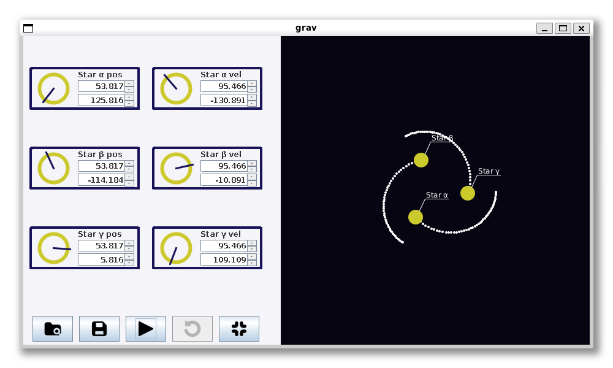

  

<h1 align="center">grav</h1>

<strong>2D three-body gravitational simulation</strong>

**grav** is a two-dimensional simulation of the classical three-body problem: the motion of three celestial bodies interacting through gravity, based on Newton's laws of motion.

## Screenshot

## Features

- **Three-body simulation:** Watch three bodies move in one another's gravitational fields.
- **Editable initial conditions:** Set each body's position and velocity using the controls on the left.
- **Polar-coordinate input:** Enter a vector's magnitude and its direction in degrees, measured from the positive x-axis. A small dial visualizes the direction.
- **Simulation controls:** Start, pause, and reset the simulation to its state before the last run.
- **Save and restore:** Save the current state and load it again later.
- **Center of mass:** Shift the position coordinates so the system's center of mass is at `(0, 0)`.
- **Motion trails:** Follow each body's previous positions along a white trail. The spacing between trail markers helps illustrate how quickly a body was moving.

## Using the application

1. Set the **position** (`pos`) and **velocity** (`vel`) vectors for each of the three bodies (α, β, γ) in the left panel.
2. Enter the **magnitude** in the upper field and the **angle** (in degrees) in the lower field of each vector control.
3. Start the simulation to see the bodies move in the right-hand view.
4. Pause the simulation to edit the initial conditions, or save and restore a state as needed.
5. After manually changing positions, use the center-of-mass control to place the center of mass back at `(0, 0)`.

## Interface

The **left panel** contains controls for the position and velocity of the three bodies, along with simulation actions. The **right panel** displays their current positions and the trails left by their movement.
